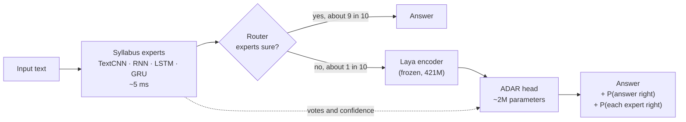
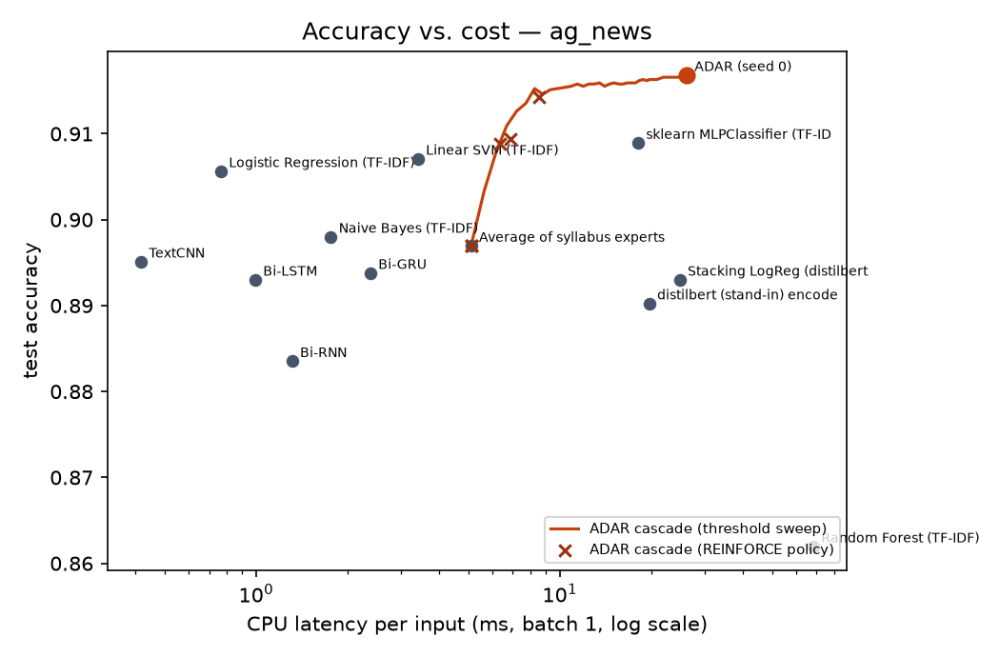
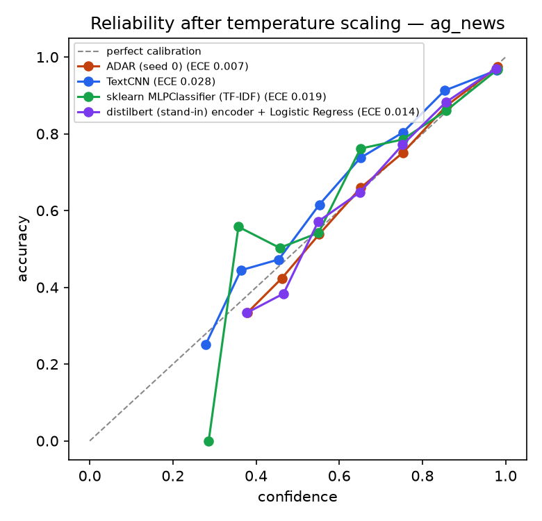

<div align="center">

# ADAR

### Adaptive Deep Architecture Routing with a System-One decision head

A small trained head on top of the open System-One model **Laya** and the classic
deep-learning architectures. For every input it answers three questions:
**what is the answer, which architecture should I trust here, and how sure am I?**

[](https://kaggle.com/kernels/welcome?src=https://github.com/Harsh4-Dev/System-One-DLE/blob/main/notebooks/adar_kaggle.ipynb)


[**Read the plain-language explainer →**](docs/MAIN.md)

</div>

---

## Why

| Problem | Evidence (AG News test set) |
|---|---|
| **Models are confidently wrong.** | 21–23% of the wrong answers from TextCNN, LSTM and GRU carry more than 90% confidence. |
| **Keeping one architecture wastes accuracy.** | The best single expert is right on 89.5% of inputs; at least one of the four experts is right on **92.7%**. |
| **Strong models are slow.** | A TextCNN takes 0.4 ms per input on a laptop CPU; a transformer encoder takes 20 ms or more. |
| **Even System-One models drift.** | Laya's fine-tuned checkpoint has ECE 0.213 on the public typed-decisions leaderboard. |

## How it works



The **ADAR head** turns each input into a short row of tokens and mixes them with a 2-layer transformer:

| Token | Built from |
|---|---|
| `STATE` | the frozen Laya embedding of the input |
| `OPTION` × K | Laya's embedding of each label's *description*, plus every expert's vote for it |
| `EXPERT` × 4 | how sure each syllabus expert is and whether it agrees with the others |

It returns three typed outputs, in the style of System-One models:

- **choice**: a calibrated probability for every label;
- **noul per expert**: "is this expert right on *this* input?", which becomes a per-input routing weight for its vote;
- **act**: "is my own answer right?", used to abstain or escalate.

The head is trained with **proper scoring rules** (log score + Brier) on **out-of-fold** expert
opinions, then temperature-scaled. A **cascade router** (threshold or **REINFORCE** policy gradient)
calls Laya only when the cheap experts are unsure.

## Results

> Local QC run with **DistilBERT standing in for Laya's encoder** (Laya's weights were not
> downloadable where the code was built): AG News, 30,000 training rows, full 7,600-row test set.
> The Kaggle notebook reproduces these tables with the real Laya encoder.
> A claim counts only when its paired-bootstrap 95% CI excludes zero; **13/13 QC gates pass**.

| Model | Accuracy | NLL ↓ | Brier ↓ | ECE ↓ | CPU ms / input |
|---|---:|---:|---:|---:|---:|
| Random Forest (TF-IDF) | 86.2% | 0.399 | 0.202 | 0.016 | 68.3 |
| Bi-RNN | 88.4% | 0.354 | 0.177 | 0.024 | 1.3 |
| Bi-LSTM | 89.3% | 0.329 | 0.167 | 0.025 | 1.0 |
| Bi-GRU | 89.4% | 0.323 | 0.164 | 0.030 | 2.4 |
| TextCNN | 89.5% | 0.332 | 0.164 | 0.028 | 0.4 |
| Logistic Regression (TF-IDF) | 90.6% | 0.298 | 0.147 | 0.020 | 0.8 |
| Linear SVM (TF-IDF) | 90.7% | 0.287 | 0.143 | 0.009 | 3.4 |
| sklearn MLP (TF-IDF) | 90.9% | 0.289 | 0.144 | 0.019 | 18.1 |
| **ADAR cascade** (expensive path on 9% of inputs) | **91.2%** | 0.295 | 0.144 | 0.021 | **7.0** |
| **ADAR** (3 seeds) | **91.7% ± 0.1** | **0.244** | **0.127** | **0.007** | 26.1 |

- **+0.8 points** over the best scikit-learn model (95% CI +0.3 to +1.3) and **+2.2** over the best syllabus model.
- **15% lower log-loss** than the best baseline: more honest probabilities.
- The cascade scores higher than every baseline at **about a quarter of ADAR's CPU cost**.

<table>
<tr>
<td width="50%"></td>
<td width="50%"></td>
</tr>
<tr>
<td align="center"><sub>Accuracy for the cost. The cascade curve sits above every baseline from about 7 ms.</sub></td>
<td align="center"><sub>Confidence vs. real accuracy. ADAR stays closest to the diagonal.</sub></td>
</tr>
</table>

**Ablations:** removing the experts costs 0.9 points, removing the encoder costs 2.0 (both significant).
Removing attention costs 0.2 points, which is not significant: attention mainly improves the probabilities.
Full report: [`docs/qc/ag_news_standin/REPORT.md`](docs/qc/ag_news_standin/REPORT.md).

## Quick start

### On Kaggle (recommended: free GPU T4 ×2)

1. Import [`notebooks/adar_kaggle.ipynb`](notebooks/adar_kaggle.ipynb) (**File → Import Notebook**).
2. **Session options:** Accelerator **GPU T4 ×2**, Internet **On**.
3. **Save Version → Save & Run All.** About 1.5–3 h for the full run, 30–45 min with `PROFILE = "quick"`.
4. Download `adar_outputs.zip`: comparison tables and plots, the publishable head, typed-decisions results.

The run checkpoints every epoch and every embedding shard, and skips finished stages when re-run.
If a session dies, attach its output as an input and run again. Details: [`docs/KAGGLE_SETUP.md`](docs/KAGGLE_SETUP.md).

### Use a trained head

```python
from adar.inference import ADARClassifier

clf = ADARClassifier.from_pretrained("adar_run/publish/adar-head-ag_news")
clf.predict(["NASA's new telescope captured images of a distant galaxy cluster."])
# [{'label': 'sci_tech', 'probabilities': {'world': 0.051, 'sports': 0.0003, 'business': 0.0011,
#    'sci_tech': 0.9476}, 'p_head_correct': 0.9732, 'escalate': False,
#    'p_expert_correct': {...}, 'routing_weights': {...}}]   <- real output from the Kaggle run
```

### Run the tests locally

```bash
pip install torch scikit-learn scipy transformers safetensors pytest
python -m pytest -q tests
```

## Repository

```
adar/                  the package (the notebook writes these exact files)
  head.py              the ADAR System-One head
  experts.py           TextCNN, RNN, LSTM, GRU with out-of-fold training
  encoder.py           frozen Laya encoder, sharded multi-GPU embedding cache
  router.py            threshold + REINFORCE cascade router
  baselines.py         scikit-learn baselines
  laya_tasks.py        Laya zero-shot + typed-decisions leaderboard evaluation
  pipeline.py          resumable stages; runstate.py tracks them
  report.py            tables, QC gates, plots, model cards, bundle
  inference.py         load a published head and classify text
notebooks/             adar_kaggle.ipynb (generated by tools/build_notebook.py)
tests/                 resume/failure handling, metrics, head structure, scorers
docs/                  explainer, setup, leaderboard and publishing guides, QC evidence
```

## Documentation

| Document | What it covers |
|---|---|
| [`docs/MAIN.md`](docs/MAIN.md) | **Start here.** The problem, the fix and the improvement, in plain language |
| [`docs/KAGGLE_SETUP.md`](docs/KAGGLE_SETUP.md) | Running on Kaggle, resuming after failures, troubleshooting |
| [`docs/LEADERBOARD_SUBMISSION.md`](docs/LEADERBOARD_SUBMISSION.md) | typed-decisions checklist, course comparison files, RouterArena plan |
| [`docs/GITHUB_AND_HF_UPLOAD.md`](docs/GITHUB_AND_HF_UPLOAD.md) | Making the repo public, publishing the heads on Hugging Face |
| [`docs/LOCAL_QC.md`](docs/LOCAL_QC.md) | What was verified before the Kaggle run, and what was not |

## Deep Learning syllabus coverage

| Unit | In ADAR |
|---|---|
| I | TextCNN, backpropagation, initialisation, BatchNorm, gradient clipping, AdamW with a cosine schedule |
| II | CNN classification; training a new head on a frozen pretrained network |
| III | RNN, LSTM, GRU; embeddings; attention and a transformer head; a BERT-family encoder (Laya) |
| IV | REINFORCE policy-gradient router (reward = correct − λ·cost) |

## Limitations

- Results above use a stand-in encoder; report the Kaggle numbers with real Laya.
- Laya is frozen; only the ~2M-parameter head is trained.
- Text classification only (AG News, Emotion) so far.
- On typed-decisions, ADAR-Cal re-calibrates Laya's probabilities; it does not change its answers.

## Acknowledgements

Built on [Laya](https://huggingface.co/convaiinnovations/laya) by Convai Innovations (Apache-2.0),
the open System-One model in the line started by TypeSafe AI's Jev. Datasets: AG News and
DAIR Emotion. Benchmark: [typed-decisions](https://huggingface.co/datasets/LocalLLaMA/typed-decisions).
