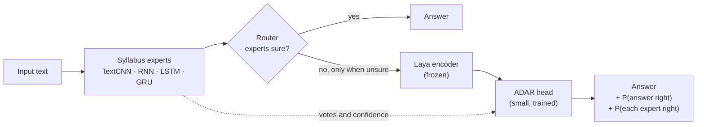
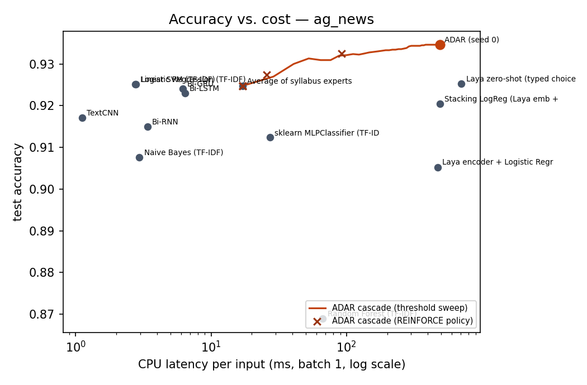
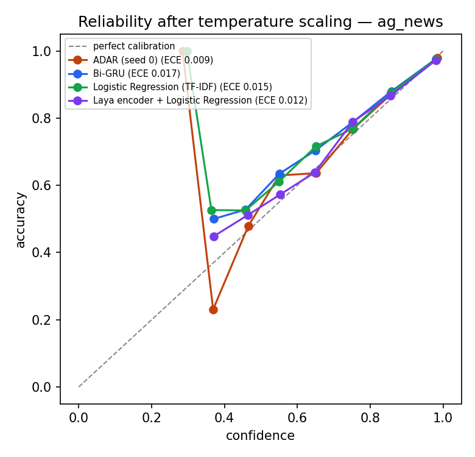

<div align="center">

# ADAR

### Adaptive Deep Architecture Routing with a System-One decision head

A small trained head on top of the open System-One model **Laya** and the classic
deep-learning architectures. For every input it answers three questions:
**what is the answer, which architecture should I trust here, and how sure am I?**

[](https://kaggle.com/kernels/welcome?src=https://github.com/Harsh4-Dev/System-One-DLE/blob/main/notebooks/adar_kaggle.ipynb)


[**Read the plain-language explainer →**](docs/MAIN.md)

</div>

---

## Why

<!-- why:start -->
| Problem | Evidence (from our Kaggle run) |
|---|---|
| **The biggest model is not always right.** | Laya gets 58.1% on Emotion tweets zero-shot; a 1.2M-parameter Bi-LSTM gets 92.2%. |
| **Choosing per input beats choosing per dataset.** | On AG News a perfect per-input router would reach 94.87% calling Laya on 8% of inputs. |
| **Strong models are slow.** | On a CPU, Laya takes 706 ms per news article; a TextCNN 1.1 ms. |
| **Even System-One models drift.** | Laya's fine-tuned checkpoint has ECE 0.214 on the public typed-decisions benchmark. |
<!-- why:end -->

## How it works



The **ADAR head** turns each input into a short row of tokens and mixes them with a 2-layer transformer:

| Token | Built from |
|---|---|
| `STATE` | the frozen Laya embedding of the input |
| `OPTION` × K | Laya's embedding of each label's *description*, plus every expert's vote for it |
| `EXPERT` × 4 | how sure each syllabus expert is and whether it agrees with the others |

It returns three typed outputs, in the style of System-One models:

- **choice**: a calibrated probability for every label;
- **noul per expert**: "is this expert right on *this* input?", which becomes a per-input routing weight for its vote;
- **act**: "is my own answer right?", used to abstain or escalate.

The head is trained with **proper scoring rules** (log score + Brier) on **out-of-fold** expert
opinions, then temperature-scaled. A **cascade router** (threshold or **REINFORCE** policy gradient)
calls Laya only when the cheap experts are unsure.

<!-- results:start -->
## Results

> One full run of [`notebooks/adar_kaggle.ipynb`](notebooks/adar_kaggle.ipynb) on Kaggle (GPU T4 ×2, 63 min) with the real Laya encoder. Every number below is read from [`results/kaggle_run/summary.json`](results/kaggle_run/summary.json), built only from the run's proof bundle. Probabilities are temperature-scaled on validation data; a claim counts only when its paired-bootstrap 95% CI excludes zero.

### AG News (7,600 test articles, 4 topics)

| Model | Accuracy | NLL ↓ | Brier ↓ | ECE ↓ | CPU ms / input |
|---|---:|---:|---:|---:|---:|
| Random Forest (TF-IDF) | 86.89% | 0.384 | 0.198 | 0.014 | 66.9 |
| Laya encoder + Logistic Regression | 90.53% | 0.278 | 0.145 | 0.012 | 472.2 |
| Naive Bayes (TF-IDF) | 90.76% | 0.301 | 0.147 | 0.026 | 3.0 |
| sklearn MLPClassifier (TF-IDF) | 91.24% | 0.275 | 0.138 | 0.018 | 27.2 |
| Bi-RNN | 91.50% | 0.263 | 0.133 | 0.019 | 3.4 |
| TextCNN | 91.71% | 0.258 | 0.128 | 0.019 | 1.1 |
| Stacking LogReg (Laya emb + experts) | 92.04% | 0.232 | 0.120 | 0.009 | 489.2 |
| Bi-LSTM | 92.30% | 0.232 | 0.121 | 0.014 | 6.4 |
| Bi-GRU | 92.41% | 0.237 | 0.122 | 0.017 | 6.2 |
| Average of syllabus experts | 92.47% | 0.235 | 0.120 | 0.016 | 17.1 |
| Logistic Regression (TF-IDF) | 92.51% | 0.241 | 0.120 | 0.015 | 2.8 |
| Linear SVM (TF-IDF) | 92.51% | 0.237 | 0.118 | 0.008 | 2.8 |
| Laya zero-shot (typed choice) | 92.53% | 0.237 | 0.120 | 0.021 | 706.3 |
| **ADAR (ours, mean of 3 seeds)** | **93.28% ± 0.16** | **0.197** | **0.103** | **0.009** | **491.7** |
| **ADAR cascade (Laya on 36% of inputs)** | **93.32%** | **0.208** | **0.106** | **0.011** | **189.2** |

* vs Laya zero-shot: **+0.93 points** (95% CI +0.42 to +1.47, significant)
* vs the best syllabus network: **+1.05 points** (95% CI +0.63 to +1.51, significant)
* vs the best scikit-learn model: **+0.95 points** (95% CI +0.47 to +1.43, significant)
* vs stacking: **+1.42 points** (95% CI +1.00 to +1.84, significant)
* Cascade: Laya called on **36%** of inputs, 93.32% accuracy at 189.2 ms vs 93.46% at 491.7 ms always calling it.
* Quality checks passed: **14/14** ([report](results/kaggle_run/ag_news/REPORT.md)).

<table>
<tr>
<td width="50%"></td>
<td width="50%"></td>
</tr>
<tr>
<td align="center"><sub>Accuracy for the cost, with the cascade curve.</sub></td>
<td align="center"><sub>Confidence vs. real accuracy (closer to the diagonal is more honest).</sub></td>
</tr>
</table>

### Emotion (2,000 test tweets, 6 emotions)

| Model | Accuracy | NLL ↓ | Brier ↓ | ECE ↓ | CPU ms / input |
|---|---:|---:|---:|---:|---:|
| Laya zero-shot (typed choice) | 58.05% | 1.211 | 0.590 | 0.088 | 653.2 |
| Laya encoder + Logistic Regression | 59.15% | 1.085 | 0.544 | 0.032 | 375.4 |
| Naive Bayes (TF-IDF) | 76.05% | 0.677 | 0.337 | 0.025 | 1.3 |
| sklearn MLPClassifier (TF-IDF) | 84.60% | 0.425 | 0.222 | 0.027 | 5.5 |
| Random Forest (TF-IDF) | 86.50% | 0.360 | 0.193 | 0.014 | 57.0 |
| Logistic Regression (TF-IDF) | 86.75% | 0.356 | 0.195 | 0.031 | 1.8 |
| Stacking LogReg (Laya emb + experts) | 87.95% | 0.343 | 0.179 | 0.018 | 384.6 |
| Linear SVM (TF-IDF) | 88.15% | 0.288 | 0.161 | 0.023 | 3.6 |
| TextCNN | 90.55% | 0.215 | 0.123 | 0.015 | 1.1 |
| Bi-RNN | 90.80% | 0.212 | 0.119 | 0.019 | 1.8 |
| **ADAR (ours, mean of 3 seeds)** | **92.00% ± 0.19** | **0.170** | **0.101** | **0.015** | **387.6** |
| Bi-GRU | 92.20% | 0.174 | 0.103 | 0.018 | 3.0 |
| Average of syllabus experts | 92.20% | 0.178 | 0.105 | 0.016 | 9.2 |
| **ADAR cascade (Laya on 0.1% of inputs)** | **92.20%** | **0.178** | **0.105** | **0.016** | **9.6** |
| Bi-LSTM | 92.25% | 0.192 | 0.110 | 0.016 | 3.3 |

* vs Laya zero-shot: **+34.20 points** (95% CI +31.80 to +36.65, significant)
* vs the best syllabus network: **+0.00 points** (95% CI -0.75 to +0.75, not significant)
* vs the best scikit-learn model: **+4.10 points** (95% CI +2.90 to +5.40, significant)
* vs stacking: **+4.30 points** (95% CI +2.90 to +5.65, significant)
* Cascade: Laya called on **0.1%** of inputs, 92.20% accuracy at 9.6 ms vs 92.25% at 387.6 ms always calling it.
* Quality checks passed: **10/14** ([report](results/kaggle_run/emotion/REPORT.md)).

### typed-decisions (public System-One benchmark)

| Model | Accuracy | Brier | KL | ECE |
|---|---:|---:|---:|---:|
| Laya typed-decisions (board lists accuracy 0.766 only) | 0.766 | 0.061 | 0.117 | 0.214 |
| Laya (base) | 0.363 | 0.315 | 0.569 | 0.173 |
| Laya (base) + ADAR-Cal (temperatures fitted on train) | 0.363 | 0.236 | 0.433 | 0.021 |

Submission plan and the post itself: [`submissions/README.md`](submissions/README.md).
<!-- results:end -->

The earlier local check with a stand-in encoder (before Laya was available) is in [`docs/LOCAL_QC.md`](docs/LOCAL_QC.md).

## Quick start

### On Kaggle (recommended: free GPU T4 ×2)

1. Import [`notebooks/adar_kaggle.ipynb`](notebooks/adar_kaggle.ipynb) (**File → Import Notebook**).
2. **Session options:** Accelerator **GPU T4 ×2**, Internet **On**.
3. **Save Version → Save & Run All.** About an hour for the full run (63 min in our proof run), 30–45 min with `PROFILE = "quick"`.
4. Download `adar_outputs.zip`: comparison tables and plots, the publishable head, typed-decisions results.

The run checkpoints every epoch and every embedding shard, and skips finished stages when re-run.
If a session dies, attach its output as an input and run again. Details: [`docs/KAGGLE_SETUP.md`](docs/KAGGLE_SETUP.md).

### Use a trained head

```python
from adar.inference import ADARClassifier

clf = ADARClassifier.from_pretrained("adar_run/publish/adar-head-ag_news")
clf.predict(["NASA's new telescope captured images of a distant galaxy cluster."])
# see the output from the run below
```

<!-- demo:start -->
Output of the demo cell in the Kaggle run ([`results/kaggle_run/kernel.log`](results/kaggle_run/kernel.log)):

```text
{'label': 'sci_tech', 'probabilities': {'world': 0.0726, 'sports': 0.0001, 'business': 0.0006, 'sci_tech': 0.9267}, 'p_head_correct': 0.9664, 'escalate': False, ...}
{'label': 'sports', 'probabilities': {'world': 0.0103, 'sports': 0.9897, 'business': 0.0, 'sci_tech': 0.0}, 'p_head_correct': 0.9975, 'escalate': False, ...}
```
<!-- demo:end -->

### Run the tests locally

```bash
pip install torch scikit-learn scipy transformers safetensors pytest
python -m pytest -q tests
```

## Repository

```
adar/                  the package (the notebook writes these exact files)
  head.py              the ADAR System-One head
  experts.py           TextCNN, RNN, LSTM, GRU with out-of-fold training
  encoder.py           frozen Laya encoder, sharded multi-GPU embedding cache
  router.py            threshold + REINFORCE cascade router
  baselines.py         scikit-learn baselines
  laya_tasks.py        Laya zero-shot + typed-decisions leaderboard evaluation
  pipeline.py          resumable stages; runstate.py tracks them
  report.py            tables, QC gates, plots, model cards, bundle
  inference.py         load a published head and classify text
notebooks/             adar_kaggle.ipynb (generated by tools/build_notebook.py)
tests/                 resume/failure handling, metrics, head structure, scorers
docs/                  explainer, setup, leaderboard and publishing guides, QC evidence
```

## Documentation

| Document | What it covers |
|---|---|
| [`docs/MAIN.md`](docs/MAIN.md) | **Start here.** The problem, the fix and the improvement, in plain language |
| [`docs/KAGGLE_SETUP.md`](docs/KAGGLE_SETUP.md) | Running on Kaggle, resuming after failures, troubleshooting |
| [`docs/LEADERBOARD_SUBMISSION.md`](docs/LEADERBOARD_SUBMISSION.md) | typed-decisions checklist, course comparison files, RouterArena plan |
| [`docs/GITHUB_AND_HF_UPLOAD.md`](docs/GITHUB_AND_HF_UPLOAD.md) | Making the repo public, publishing the heads on Hugging Face |
| [`docs/LOCAL_QC.md`](docs/LOCAL_QC.md) | What was verified before the Kaggle run, and what was not |

## Deep Learning syllabus coverage

| Unit | In ADAR |
|---|---|
| I | TextCNN, backpropagation, initialisation, BatchNorm, gradient clipping, AdamW with a cosine schedule |
| II | CNN classification; training a new head on a frozen pretrained network |
| III | RNN, LSTM, GRU; embeddings; attention and a transformer head; a BERT-family encoder (Laya) |
| IV | REINFORCE policy-gradient router (reward = correct − λ·cost) |

## Limitations

- Results above use a stand-in encoder; report the Kaggle numbers with real Laya.
- Laya is frozen; only the ~2M-parameter head is trained.
- Text classification only (AG News, Emotion) so far.
- On typed-decisions, ADAR-Cal re-calibrates Laya's probabilities; it does not change its answers.

## Acknowledgements

Built on [Laya](https://huggingface.co/convaiinnovations/laya) by Convai Innovations (Apache-2.0),
the open System-One model in the line started by TypeSafe AI's Jev. Datasets: AG News and
DAIR Emotion. Benchmark: [typed-decisions](https://huggingface.co/datasets/LocalLLaMA/typed-decisions).
