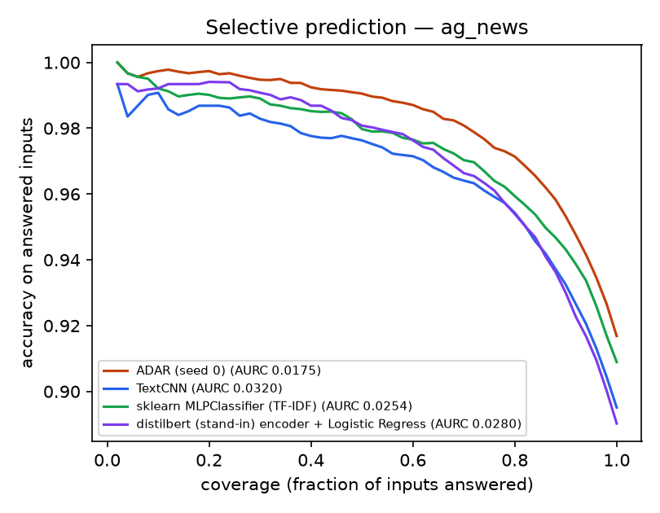

# ADAR results — ag_news

ag_news: train=30000 val=3000 test=7600 classes=4 folds=3

All probabilistic models are temperature-scaled on the validation split (ECE raw = before). CPU latency = median batch-1 time on the run's CPU. Test rows are identical for every model.

| Model | Family | Syllabus unit | Accuracy | Macro-F1 | NLL | Brier | ECE (TS) | ECE (raw) | AURC | CPU ms/sample | Params |
|---|---|---|---|---|---|---|---|---|---|---|---|
| Random Forest (TF-IDF) | scikit-learn | - | 0.8620 | 0.8610 | 0.3992 | 0.2024 | 0.0155 | 0.2098 | 0.0416 | 68.34 | - |
| Bi-RNN | Deep learning (syllabus) | III | 0.8836 | 0.8833 | 0.3536 | 0.1767 | 0.0235 | 0.0207 | 0.0367 | 1.31 | 3.39M |
| distilbert (stand-in) encoder + Logistic Regression | System One + sklearn | III | 0.8903 | 0.8901 | 0.3186 | 0.1634 | 0.0137 | 0.0505 | 0.0280 | 19.71 | 66.36M |
| Bi-LSTM | Deep learning (syllabus) | III | 0.8930 | 0.8925 | 0.3294 | 0.1668 | 0.0253 | 0.0232 | 0.0299 | 0.99 | 3.59M |
| Stacking LogReg (distilbert (stand-in) emb + experts) | Ensemble | I-III | 0.8930 | 0.8930 | 0.3113 | 0.1599 | 0.0155 | 0.0487 | 0.0266 | 24.81 | - |
| Bi-GRU | Deep learning (syllabus) | III | 0.8938 | 0.8935 | 0.3232 | 0.1642 | 0.0296 | 0.0210 | 0.0307 | 2.38 | 3.52M |
| TextCNN | Deep learning (syllabus) | I-II | 0.8951 | 0.8948 | 0.3322 | 0.1637 | 0.0277 | 0.0277 | 0.0320 | 0.42 | 3.52M |
| Average of syllabus experts | Ensemble | I-III | 0.8970 | 0.8967 | 0.3179 | 0.1592 | 0.0255 | 0.0265 | 0.0298 | 5.10 | 14.03M |
| Naive Bayes (TF-IDF) | scikit-learn | - | 0.8980 | 0.8976 | 0.3284 | 0.1591 | 0.0245 | 0.0371 | 0.0330 | 1.76 | - |
| Logistic Regression (TF-IDF) | scikit-learn | - | 0.9057 | 0.9054 | 0.2984 | 0.1472 | 0.0196 | 0.0233 | 0.0276 | 0.77 | - |
| Linear SVM (TF-IDF) | scikit-learn | - | 0.9071 | 0.9068 | 0.2872 | 0.1431 | 0.0089 | 0.0236 | 0.0277 | 3.41 | - |
| sklearn MLPClassifier (TF-IDF) | scikit-learn | - | 0.9089 | 0.9088 | 0.2887 | 0.1442 | 0.0193 | 0.0206 | 0.0254 | 18.11 | - |
| ADAR ablation: experts only | Ablation | - | 0.8967 | 0.8966 | 0.3032 | 0.1563 | 0.0144 | 0.0147 | 0.0270 | 6.35 | 2.07M |
| ADAR ablation: laya only | Ablation | - | 0.9075 | 0.9074 | 0.2756 | 0.1411 | 0.0107 | 0.0151 | 0.0237 | 20.62 | 2.07M |
| **ADAR cascade (escalates 9%)** | ADAR (ours) | I-IV | 0.9121 | 0.9119 | 0.2945 | 0.1436 | 0.0208 | 0.0208 | 0.0280 | 7.02 | - |
| ADAR ablation: no attention | Ablation | - | 0.9145 | 0.9144 | 0.2552 | 0.1326 | 0.0119 | 0.0119 | 0.0190 | 25.57 | 1.01M |
| **ADAR (ours, mean of 3 seeds)** | ADAR (ours) | I-IV | 0.9165 ± 0.0006 | 0.9165 ± 0.0006 | 0.2436 ± 0.0017 | 0.1270 ± 0.0003 | 0.0073 ± 0.0011 | 0.0092 | 0.0173 | 26.14 | 2.07M |

## QC gates (paired bootstrap, 95% CI)

- PASS — ADAR accuracy > best scikit-learn model (sklearn MLPClassifier (TF-IDF)): delta=+0.79pp, 95% CI [+0.28, +1.29]
- PASS — ADAR accuracy > best syllabus deep model (TextCNN): delta=+2.17pp, 95% CI [+1.59, +2.72]
- PASS — ADAR accuracy > best expert ensemble (Average of syllabus experts): delta=+1.99pp, 95% CI [+1.39, +2.57]
- PASS — ADAR accuracy > best Laya linear probe (distilbert (stand-in) encoder + Logistic Regression): delta=+2.66pp, 95% CI [+2.13, +3.21]
- PASS — ADAR accuracy > best stacking baseline (Stacking LogReg (distilbert (stand-in) emb + experts)): delta=+2.38pp, 95% CI [+1.83, +2.92]
- PASS — ADAR NLL lower than every baseline (best: Linear SVM (TF-IDF)): ADAR 0.2440 vs 0.2872
- PASS — ADAR BRIER lower than every baseline (best: Linear SVM (TF-IDF)): ADAR 0.1269 vs 0.1431
- PASS — ADAR ECE (after TS) <= best baseline ECE + 0.005 (best: Linear SVM (TF-IDF)): ADAR 0.0068 vs 0.0089
- PASS — full ADAR >= ADAR ablation: laya only (accuracy; NLL lower): delta=+0.93pp CI [+0.54, +1.32], NLL 0.2440 vs 0.2756
- PASS — full ADAR >= ADAR ablation: experts only (accuracy; NLL lower): delta=+2.01pp CI [+1.45, +2.59], NLL 0.2440 vs 0.3032
- PASS — full ADAR >= ADAR ablation: no attention (accuracy; NLL lower): delta=+0.24pp CI [-0.09, +0.57], NLL 0.2440 vs 0.2552
- PASS — ADAR stable across seeds (accuracy std < 0.5pp): std=0.06pp over 3 seeds
- PASS — Cascade keeps accuracy within 0.5pp of always-Laya while skipping Laya calls: acc 0.9121 vs 0.9168; Laya called on 9% of inputs; mean cost 7.0 vs 26.1 ms

## How ADAR routes between the syllabus experts (test set)

| Expert | mean routing weight α | predicted P(correct) | actual accuracy | AUC of P(correct) |
|---|---|---|---|---|
| TextCNN | 0.184 | 0.869 | 0.895 | 0.888 |
| Bi-RNN | 0.065 | 0.859 | 0.884 | 0.903 |
| Bi-LSTM | 0.117 | 0.864 | 0.893 | 0.890 |
| Bi-GRU | 0.187 | 0.866 | 0.894 | 0.889 |

## Cascade (cheap experts first, Laya + ADAR only when needed)

- tier-0 (experts) accuracy 0.8970 at 5.10 ms
- always escalate: accuracy 0.9168 at 26.1 ms
- chosen threshold (picked on validation): accuracy 0.9121, Laya called on 9.1% of inputs, mean 7.0 ms
- oracle router (upper bound): accuracy 0.9384 escalating 10.3%
- REINFORCE policy points: λ=0.05: acc 0.9142 @ 16% escalated; λ=0.1: acc 0.9093 @ 8% escalated; λ=0.2: acc 0.9088 @ 6% escalated; λ=0.4: acc 0.8970 @ 0% escalated; λ=0.8: acc 0.8970 @ 0% escalated; λ=1.6: acc 0.8970 @ 0% escalated

  
