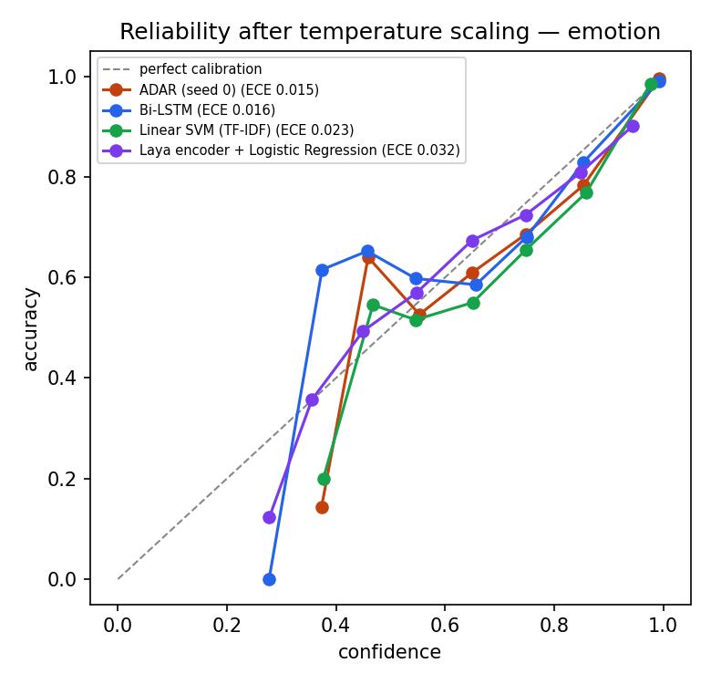
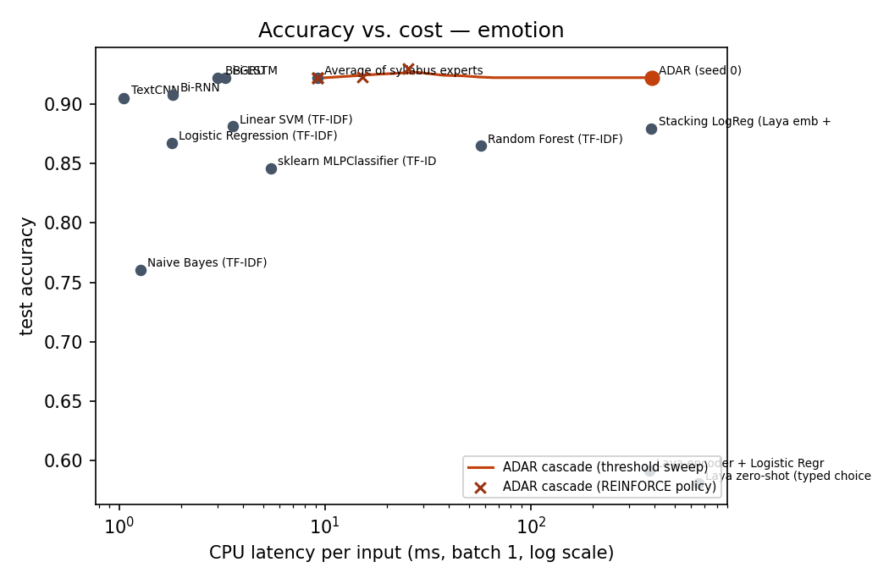
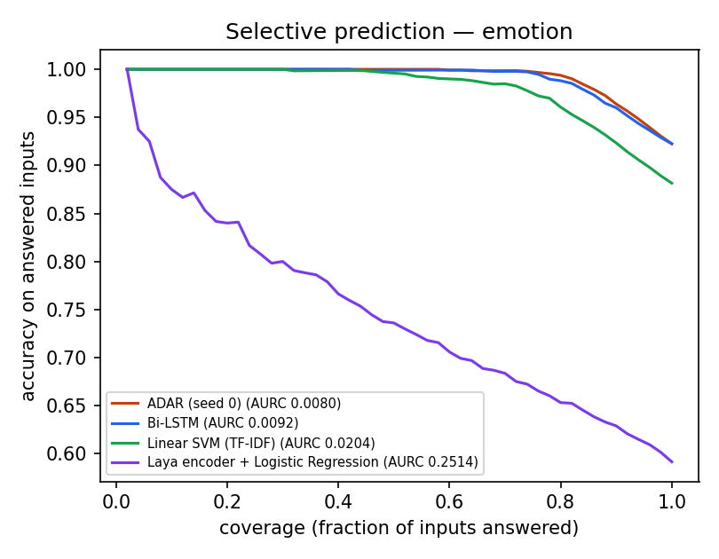

# ADAR results — emotion

emotion: train=16000 val=2000 test=2000 classes=6 folds=3

All probabilistic models are temperature-scaled on the validation split (ECE raw = before). CPU latency = median batch-1 time on the run's CPU. Test rows are identical for every model.

| Model | Family | Syllabus unit | Accuracy | Macro-F1 | NLL | Brier | ECE (TS) | ECE (raw) | AURC | CPU ms/sample | Params |
|---|---|---|---|---|---|---|---|---|---|---|---|
| Laya zero-shot (typed choice) | System One | III | 0.5805 | 0.4704 | 1.2109 | 0.5898 | 0.0877 | 0.2397 | 0.3082 | 653.23 | 394.78M |
| Laya encoder + Logistic Regression | System One + sklearn | III | 0.5915 | 0.5056 | 1.0845 | 0.5437 | 0.0321 | 0.2638 | 0.2514 | 375.44 | 394.78M |
| Naive Bayes (TF-IDF) | scikit-learn | - | 0.7605 | 0.6301 | 0.6771 | 0.3366 | 0.0251 | 0.0880 | 0.0828 | 1.27 | - |
| sklearn MLPClassifier (TF-IDF) | scikit-learn | - | 0.8460 | 0.7750 | 0.4251 | 0.2219 | 0.0268 | 0.0345 | 0.0411 | 5.45 | - |
| Random Forest (TF-IDF) | scikit-learn | - | 0.8650 | 0.8000 | 0.3596 | 0.1934 | 0.0136 | 0.2037 | 0.0346 | 56.97 | - |
| Logistic Regression (TF-IDF) | scikit-learn | - | 0.8675 | 0.8039 | 0.3562 | 0.1951 | 0.0307 | 0.0899 | 0.0304 | 1.81 | - |
| Stacking LogReg (Laya emb + experts) | Ensemble | I-III | 0.8795 | 0.8155 | 0.3430 | 0.1789 | 0.0177 | 0.0740 | 0.0294 | 384.63 | - |
| Linear SVM (TF-IDF) | scikit-learn | - | 0.8815 | 0.8222 | 0.2878 | 0.1611 | 0.0230 | 0.0523 | 0.0204 | 3.58 | - |
| TextCNN | Deep learning (syllabus) | I-II | 0.9055 | 0.8567 | 0.2149 | 0.1231 | 0.0153 | 0.0154 | 0.0122 | 1.06 | 1.15M |
| Bi-RNN | Deep learning (syllabus) | III | 0.9080 | 0.8619 | 0.2122 | 0.1194 | 0.0187 | 0.0302 | 0.0112 | 1.82 | 1.02M |
| Bi-GRU | Deep learning (syllabus) | III | 0.9220 | 0.8823 | 0.1740 | 0.1028 | 0.0184 | 0.0184 | 0.0081 | 3.02 | 1.15M |
| Average of syllabus experts | Ensemble | I-III | 0.9220 | 0.8810 | 0.1777 | 0.1052 | 0.0162 | 0.0200 | 0.0084 | 9.18 | 4.53M |
| Bi-LSTM | Deep learning (syllabus) | III | 0.9225 | 0.8816 | 0.1919 | 0.1100 | 0.0163 | 0.0168 | 0.0092 | 3.28 | 1.21M |
| ADAR ablation: laya only | Ablation | - | 0.6495 | 0.4771 | 0.9751 | 0.4860 | 0.0271 | 0.0197 | 0.1940 | 377.32 | 2.33M |
| **ADAR (ours, mean of 3 seeds)** | ADAR (ours) | I-IV | 0.9200 ± 0.0019 | 0.8790 ± 0.0054 | 0.1704 ± 0.0005 | 0.1014 ± 0.0005 | 0.0150 ± 0.0007 | 0.0181 | 0.0080 | 387.64 | 2.33M |
| ADAR ablation: experts only | Ablation | - | 0.9200 | 0.8802 | 0.1647 | 0.0970 | 0.0097 | 0.0124 | 0.0076 | 11.75 | 2.33M |
| ADAR ablation: no attention | Ablation | - | 0.9205 | 0.8732 | 0.1708 | 0.1004 | 0.0112 | 0.0139 | 0.0082 | 386.23 | 1.28M |
| **ADAR cascade (escalates 0%)** | ADAR (ours) | I-IV | 0.9220 | 0.8809 | 0.1777 | 0.1054 | 0.0162 | 0.0162 | 0.0084 | 9.56 | - |

## QC gates (paired bootstrap, 95% CI)

- PASS — ADAR accuracy > best scikit-learn model (Linear SVM (TF-IDF)): delta=+4.10pp, 95% CI [+2.90, +5.40]
- FAIL — ADAR accuracy > best syllabus deep model (Bi-LSTM): delta=+0.00pp, 95% CI [-0.75, +0.75]
- FAIL — ADAR accuracy > best expert ensemble (Average of syllabus experts): delta=+0.05pp, 95% CI [-0.75, +0.85]
- PASS — ADAR accuracy > best Laya zero-shot (Laya zero-shot (typed choice)): delta=+34.20pp, 95% CI [+31.80, +36.65]
- PASS — ADAR accuracy > best Laya linear probe (Laya encoder + Logistic Regression): delta=+33.10pp, 95% CI [+30.80, +35.35]
- PASS — ADAR accuracy > best stacking baseline (Stacking LogReg (Laya emb + experts)): delta=+4.30pp, 95% CI [+2.90, +5.65]
- PASS — ADAR NLL lower than every baseline (best: Bi-GRU): ADAR 0.1711 vs 0.1740
- PASS — ADAR BRIER lower than every baseline (best: Bi-GRU): ADAR 0.1018 vs 0.1028
- PASS — ADAR ECE (after TS) <= best baseline ECE + 0.005 (best: Random Forest (TF-IDF)): ADAR 0.0150 vs 0.0136
- PASS — full ADAR >= ADAR ablation: laya only (accuracy; NLL lower): delta=+27.30pp CI [+25.10, +29.60], NLL 0.1711 vs 0.9751
- FAIL — full ADAR >= ADAR ablation: experts only (accuracy; NLL lower): delta=+0.25pp CI [-0.65, +1.20], NLL 0.1711 vs 0.1647
- FAIL — full ADAR >= ADAR ablation: no attention (accuracy; NLL lower): delta=+0.20pp CI [-0.80, +1.20], NLL 0.1711 vs 0.1708
- PASS — ADAR stable across seeds (accuracy std < 0.5pp): std=0.19pp over 3 seeds
- PASS — Cascade keeps accuracy within 0.5pp of always-Laya while skipping Laya calls: acc 0.9220 vs 0.9225; Laya called on 0% of inputs; mean cost 9.6 vs 387.6 ms

## How ADAR routes between the syllabus experts (test set)

| Expert | mean routing weight α | predicted P(correct) | actual accuracy | AUC of P(correct) |
|---|---|---|---|---|
| TextCNN | 0.395 | 0.866 | 0.905 | 0.920 |
| Bi-RNN | 0.365 | 0.826 | 0.908 | 0.921 |
| Bi-LSTM | 0.403 | 0.848 | 0.922 | 0.906 |
| Bi-GRU | 0.435 | 0.871 | 0.922 | 0.912 |

## Cascade (cheap experts first, Laya + ADAR only when needed)

- tier-0 (experts) accuracy 0.9220 at 9.18 ms
- always escalate: accuracy 0.9225 at 387.6 ms
- chosen threshold (picked on validation): accuracy 0.9220, Laya called on 0.1% of inputs, mean 9.6 ms
- oracle router (upper bound): accuracy 0.9395 escalating 7.8%
- REINFORCE policy points: λ=0.05: acc 0.9230 @ 2% escalated; λ=0.1: acc 0.9305 @ 4% escalated; λ=0.2: acc 0.9220 @ 0% escalated; λ=0.4: acc 0.9220 @ 0% escalated; λ=0.8: acc 0.9220 @ 0% escalated; λ=1.6: acc 0.9220 @ 0% escalated

  
